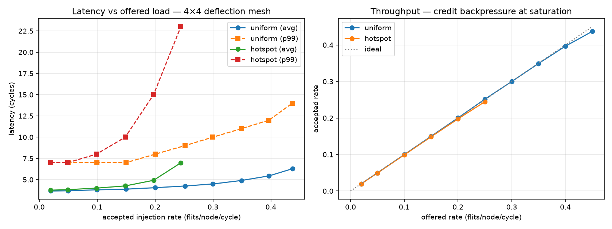

# noc-deflection-router

A synthesizable Network-on-Chip: a parameterized 2D-mesh of **deflection
("hot-potato") routers** in SystemVerilog, verified cycle-accurately with
Verilator testbenches that prove zero-loss delivery for hundreds of thousands
of flits and produce the standard latency-vs-load characterization.

Instead of the large input buffers that dominate conventional router area
(30–75% of silicon in published designs), contention is resolved by
**deflection**: when two flits want the same output port, the loser is
intentionally misrouted to any free neighbour and keeps moving. Tiny 2-flit
FIFOs plus **credit-based flow control** guarantee nothing is ever dropped.

```
            ┌─────────┐   N
            │  Router │◄──────►          flit (53 bits, self-routing):
    W ◄────►│ ┌─────┐ │   E             ┌───────┬───────┬────────┬─────┬──────┬─────┬─────────┐
            │ │ 5x5 │ │◄──────►         │ dst   │ src   │ pkt_id │ seq │ last │ age │ payload │
            │ │alloc│ │                 └───────┴───────┴────────┴─────┴──────┴─────┴─────────┘
            │ └─────┘ │   S
            │  Local  │◄──────►         XY-preferred  ──contention──►  deflect
            └────▲────┘                 oldest-first allocation (livelock-free)
                 │ inject/eject
                 NI
```

## Features

- **2D-mesh topology**, parameterized `NX×NY` (default 4×4; same RTL scales to 16×16)
- **XY dimension-ordered routing** as the productive path, **deflection on
  contention** — a flit stalls only when *all five* ports are busy in the same cycle
- **Oldest-first allocation** with a saturating age field — the standard
  livelock-freedom construction for deflection networks
- **Credit-based flow control** on every link (2-deep FIFOs) — zero flit loss by
  construction, verified empirically
- **Flit-level switching** with head/body/tail framing and destination
  reassembly (BLESS-style; see [docs/architecture.md](docs/architecture.md)
  for why classic wormhole path-reservation cannot survive deflection)
- **Network interface** (`ni.sv`): packet→flit serializer with credit handling

## Verified behaviour (Verilator, cycle-accurate)

| Test | What it proves |
|---|---|
| `tb_router` A | Two flits collide on East → exactly one wins, the other leaves on a different port the *same cycle* (deflected, not stalled) |
| `tb_router` B | Credits exhausted → deflect; all ports exhausted → stall; refill → drain. 10/10 flits conserved |
| `tb_router` C | Locally-addressed flits eject on the Local port, payload intact |
| `tb_ni` | Head/body/tail framing, per-flit sequence/payload, stall at 0 credits |
| `tb_mesh` Phase 1 | 37k flits in random 1–4-flit packets: every flit delivered **exactly once** to the right node, reassembly-clean under deflection reordering |
| `tb_mesh` Phase 2 | Load sweep 0.02→0.45 flits/node/cycle, uniform + hotspot: 100% delivery and full drain at every point (~700k flits, zero lost) |



Measured on the 4×4 mesh: ~3.7-cycle average latency at low load (≈ hops + 1
cycle/hop), graceful degradation to 6.3 cycles at 0.45 flits/node/cycle with
credit backpressure visibly throttling acceptance — and the hotspot pattern
saturating earlier (p99 = 23 cycles at rate 0.25), exactly as NoC theory
predicts.

## Running it

```bash
brew install verilator          # or apt install verilator (>= v5)
make test                       # unit tests + full-mesh sweep (~1 min)
make plots                      # results/sweep.csv -> docs/latency_vs_load.png
```

## Repository layout

```
rtl/      noc_pkg.sv  router.sv  mesh.sv  ni.sv      (synthesizable SystemVerilog)
tb/       tb_router.cpp  tb_ni.cpp  tb_mesh.cpp      (Verilator C++ testbenches)
scripts/  plot_results.py
docs/     architecture.md  latency_vs_load.png
```

## Scale ("terabit", honestly)

The simulated config is deliberately small so regressions run in seconds. The
same microarchitecture at a synthesis-oriented operating point — 8×8 mesh,
256-bit links, 1.5 GHz — gives **~6.1 Tb/s bisection bandwidth** (16 bisection
links × 384 Gb/s) and ~123 Tb/s aggregate switching. The simulation proves the
logic; the math states what the architecture scales to. Full derivation and
design rationale in [docs/architecture.md](docs/architecture.md).
